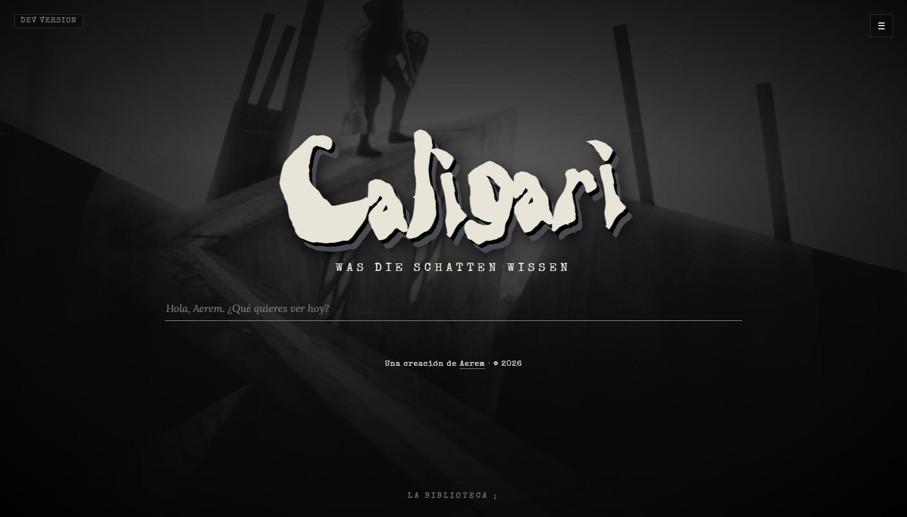
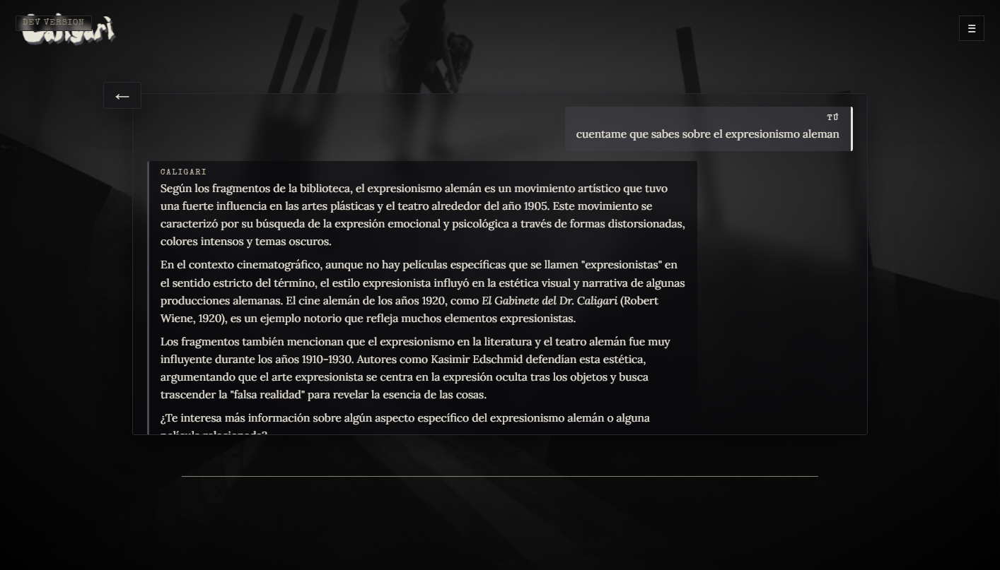

  <a href="caligari_README.md"><b>English</b></a> │ 
  <a href="caligari_README_es.md"><b>Español</b></a>

# 🎥 Caligari — Local AI for Cinema (RAG + LLM)

A **100% local** conversational assistant specialized in film theory and history. Built using a custom RAG pipeline over a corpus of ~287 books, with a strict engineering focus on **preventing model hallucinations**. This is a personal learning project where my main objectives were building the pipeline and, above all, **driving its QA and quality engineering**.

**Stack:** Python · Ollama (Qwen2.5) · bge-m3 embeddings · ChromaDB · Flask

## My Approach (QA + Direction)
- **Defect Detection:** Identified and isolated model hallucinations, which directly motivated the implementation of automated output validation.
- **AI Quality Engineering:** Implemented *grounding* + *guardrails* to strictly constrain the model's generation limits and eliminate fabrication.
- **Live Testing:** Designed custom live testing strategies alongside disciplined documentation (decision logs and system versioning).

When asked about film theory, it responds by **citing real books from the corpus** with accurate attribution—anti-hallucination in action:

## Further Details
- 📐 [How the RAG pipeline works](pipeline.md)
- ✅ [Live Testing QA Checklist Excerpt](qa-checklist.md)

🔒 *Private code repository — access available upon request.*

---
_Caligari · © 2026 Aerem · All rights reserved._
