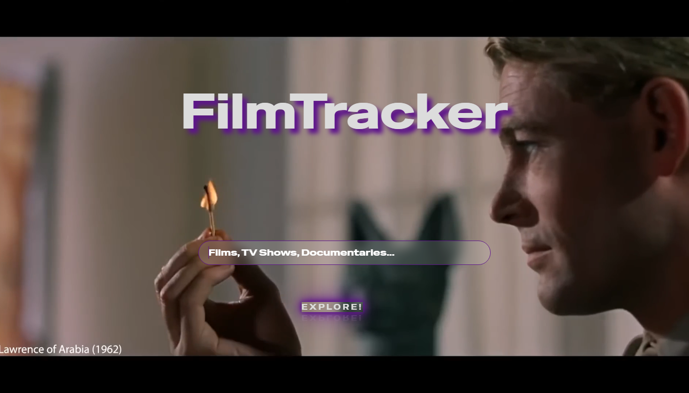
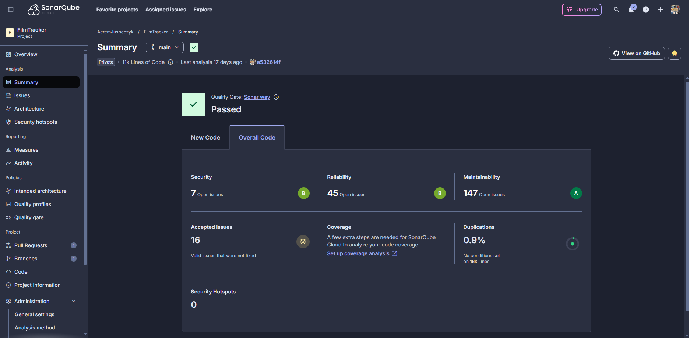
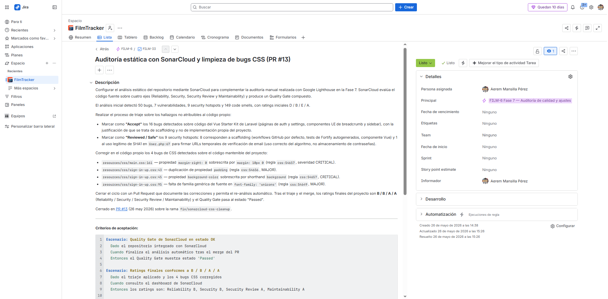
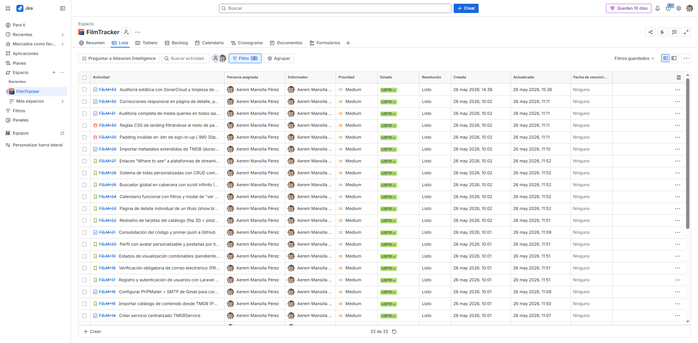
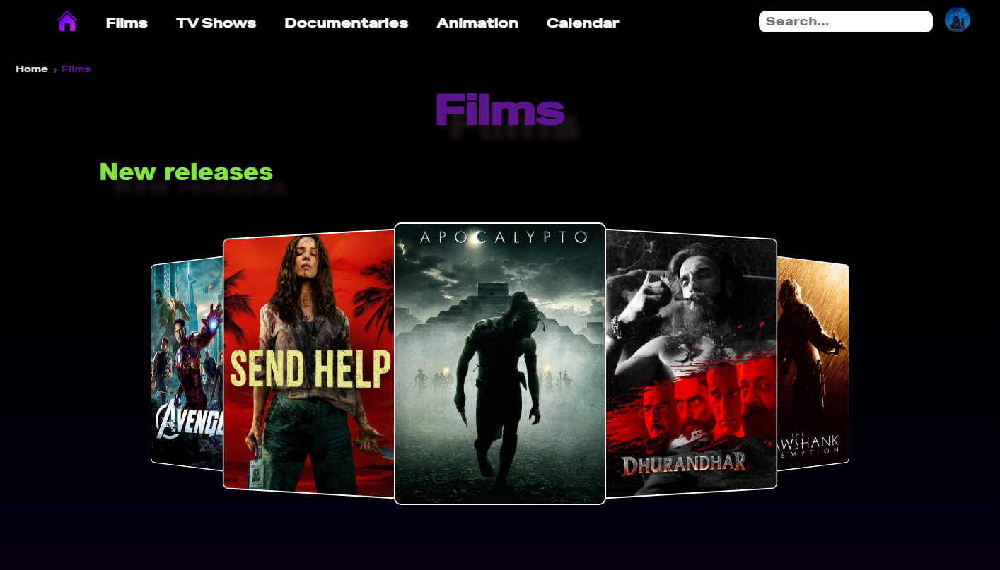
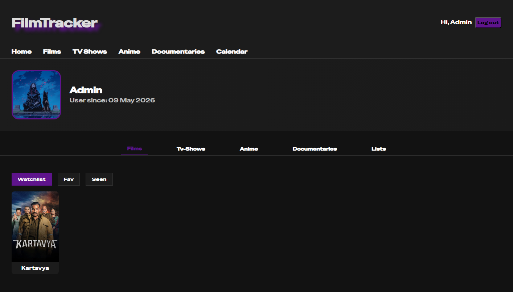

  <a href="filmtracker_README_eng.md"><b>English</b></a> │ 
  <a href="filmtracker_README.md"><b>Español</b></a>

# 🎬 FilmTracker — Movies & TV Shows Web App

A **full-stack** web application built to centralize media consumption scattered across multiple platforms. Discover, search, track, and plan movies, TV shows, anime, and documentaries within a single unified interface: *"All your streaming platforms in one."*

Features catalogs imported via the **TMDB API**, personal profiles (lists, watchlist, watched, favorites), a filterable release calendar, global search, and direct deep links to streaming platforms.

An **individual** capstone graduation project (2nd year of DAW - Web Application Development), assuming all software development lifecycle roles—including **QA**.

**Stack:** PHP 8.2 · Laravel 12 · MariaDB · JavaScript · Blade · Vite · TMDB API · Git/GitHub (Feature Branch + Pull Requests)

## My QA & Quality Engineering Work

**Accessibility — Lighthouse Auditing:** Achieved an average score of **94.75/100** across 4 key pages (Landing: 100 · Films: 90 · Calendar: 91 · Details: 98) by ensuring semantic HTML, ARIA attributes, WCAG contrast compliance, and visible focus indicators. Residual issues were fully documented, and future improvements were formally declared.

**Static Analysis — SonarCloud:** Audited the entire repository, **accurately distinguishing legacy technical debt inherited from the Laravel starter kit from bugs in my own code**. Addressed 16 legacy bugs accepted as debt, reviewed 9 security hotspots marked as *Safe*, and fixed 4 custom code defects. Consequently, Reliability and Security grades rose from **D/E to B/A**.

**Traceability & Test Management — Jira + GitHub:** Reconstructed full project traceability in **Jira** (applying skills learned during my internship). Managed **33 issues** spanning epics, user stories, tasks, and bugs, using **Gherkin syntax for acceptance criteria**. Structured bug reports included type, severity, root-cause analysis, resolving PR, and fix verification. Maintained a *planning → coding → PR → main* workflow across **13 Pull Requests** and **37 signed commits**.

**Testing & Robustness:** Maintained documented manual testing procedures (with automated PHPUnit/Pest architectures ready). Implemented security best practices: bcrypt password hashing, CSRF protection, signed/expiring email verification, and SQL wildcard escaping within the search engine. Graceful error handling was established for TMDB API downtime and mail server failures.

**Documentation:** Authored a comprehensive **24-page Brand Identity Guidelines manual**, alongside a deployment-ready root README outlining the complete installation and setup guide.

## The App

🔒 *Private code repository — access available upon request.*

---
_FilmTracker · © 2026 Aerem · All rights reserved._
